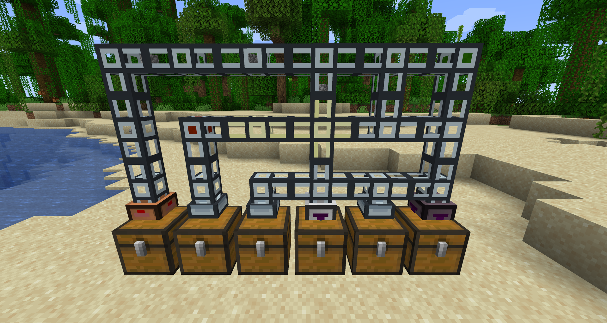

# Modern Item Ducts

A Minecraft **26.1.2 / NeoForge 26.1.2** mod: tiered item ducts with servos, retrievers and filters,
in the style of the classic 1.12-era item-duct mods. Mod id `modernitemducts`, MIT licensed.

> Branch `26.1.2` (NeoForge). Other versions: `main` (Forge 1.20.1), `1.21.1` (NeoForge 1.21.1).
> Behaviour, ids, art and GUI are the same on all of them. Jar: `modernitemducts-<version>+mc26.1.2.jar`.



## Provenance

The behaviour was reimplemented clean-room style: the code was written from a plain-language
*behaviour specification* only, and no code, lang files or recipes of any other duct mod were
decompiled, copied or consulted while writing it. All code, models, recipes and text are original.

The art is original pixel art generated by `tools/generate_assets.py` (no original textures are
copied or embedded). It was *inspired by* the look of the classic 1.12-era Thermal Dynamics item
ducts and the modern Thermal Dynamics duct model layout: the slate-and-cream colour palette,
the open lattice frame with a transparent centre, the 16x16 texel density and the glyph
styles on servos, retrievers and filters were chosen by looking at those mods. Geometry numbers
(e.g. a 6-pixel-wide duct core) are common-sense dimensions, not copied files.

This mod is not affiliated with or endorsed by Thermal Series, CoFH or Team CoFH. It has no
dependency on any other mod and registers nothing outside its own `modernitemducts` namespace
(plus adding its own wrench to the common `c:tools/wrench` and `forge:tools/wrench` tags and its
ducts to `minecraft:mineable/pickaxe`).

## Contents

| Thing | Registry name | Notes |
|---|---|---|
| Item Duct / Opaque Item Duct | `item_duct`, `item_duct_opaque` | 40 progress units per block |
| Fast Item Duct / Opaque Fast Item Duct | `fast_item_duct`, `fast_item_duct_opaque` | 10 units per block (4x faster) |
| Dense / Vacuum variants | same blocks, `weight` block-state | stored on the item (`BlockStateTag`) and kept on drop |
| Item Servo (5 tiers) | `item_servo_<copper\|iron\|gold\|diamond\|netherite>` | extractor |
| Item Retriever (5 tiers) | `item_retriever_<tier>` | pulls matching items from the network |
| Item Filter (5 tiers) | `item_filter_<tier>` | restricts deliveries into an inventory |
| Item Duct Wrench | `duct_wrench` | |

Every player-facing name contains "Item" so nothing is confused with similarly named fluid or
energy attachments from other mods.

### Tiers

| Tier | Material | Interval | Items/op | Multi-slot | Speed | Filter slots | Max stock limit |
|---|---|---|---|---|---|---|---|
| 1 | copper | 60 t | 8 | no | 1 | 3 | – |
| 2 | iron | 40 t | 16 | no | 1 | 6 | – |
| 3 | gold | 20 t | 32 | no | 1 | 9 | 64 |
| 4 | diamond | 10 t | 64 | yes | 2 | 12 | 128 |
| 5 | netherite | 10 t | 64 | yes | 3 | 15 | 320 |

Flags per tier: T1 list mode only; T2 adds durability; T3+ add NBT, tag and mod matching and
sort modes. Locked flags are forced to their defaults (also on load).

## Implemented behaviour

* Duct linking on all six faces; ducts link to any block exposing the Forge `IItemHandler`
  capability on that face. All families and weights connect freely.
* **Wrench**: right-click an arm/core to block/unblock that face (the touching duct follows);
  right-click an attachment to remove it (a backlogged servo spills its backlog first);
  sneak + right-click dismantles the duct, dropping it (with its weight), all attachments,
  backlogs and every packet inside. **Any item tagged `forge:tools/wrench`, `forge:wrenches`,
  `c:wrenches`, `c:tools/wrench` or our own `modernitemducts:wrenches` works as a wrench**, so a
  wrench from another mod can be used.
* Networks are flood-filled per level and thrown away/rebuilt on any topology change, which also
  discards all cached routes.
* Routing: per-origin lock-step BFS route tables (minimum-hop physical paths; dense = +1000,
  vacuum = −1000 sort weight), sorted by weight then length; “only send what fits” simulation;
  delivery; rerouting with the two grace periods, return to servo backlog, then drop.
* Background route computation with a per-tick time budget (config), urgent synchronous tables
  for reroutes.
* In-transit ledger (“prevent over-sending”), on for plain faces, per-filter toggle.
* Servos: global-tick-aligned intervals, per-tier limits, adjustable items/op, multi-slot pulls
  on T4/T5, one packet per operation, own filter, sort modes (nearest, furthest, random,
  round-robin) on T3+, unbounded backlog with a clogged look.
* Retrievers (with own-inventory direct backlog insert) and filters, max stock.
* External pushes: into a servo face (servo rules) or a plain face (16 per call, nearest,
  never straight back out the same face).
* Redstone modes (ignore / active when unpowered / active when powered).
* GUI with ghost slots (click, shift-click), flag toggles, sort / over-send / redstone buttons
  (right-click cycles backwards), ± buttons (1, Shift+left 16, Shift+right 4), info tab.
* Full persistence of packets (including backlog-bound state) and attachment state; duct age
  restarts at 0 after loading (grace period); chunk-boundary watching.
* Client: packets drawn in transparent ducts (0.7x, slow spin, ≤16 per duct, interpolated
  between updates; sync only when packets enter or leave a duct). Opaque ducts never sync packets.

### Choices where the spec left room / quirks fixed

* **Default redstone mode is “active only when powered”, matching the original** — a newly
  placed servo or retriever does nothing until it gets a signal. Configurable with
  `defaultRedstoneMode` in `config/modernitemducts-common.toml` (`HIGH`, `LOW`, `IGNORE`).
* Blocked faces stay blocked whatever the neighbour is.
* Backlog acceptance checks *any* servo/retriever on the duct (a filter never blocks it).
* “Heading to backlog” is persisted.
* In-transit accounting counts every packet aimed at the same inventory, whatever face.
* Retrievers count items already flowing to them (no over-pull).
* Broken ducts drop everything (no 30-stack cap).
* A packet whose next duct no longer links back reroutes instead of looping.
* Packets handed to the next duct start moving the following tick (deterministic).
* Round-robin advances the cursor to just past the destination actually used.
* A servo never sends items back into its own source inventory (config `preventSourceLoop`).
* Tag matching uses **all** item tags of the filter items. Damage and NBT are separate flags
  (the NBT comparison ignores the `Damage` key).
* Homeless items: `homelessItems = DROP | VOID`.

## Art

All art is generated pixel by pixel by `tools/generate_assets.py` (re-run it after editing);
`python3 -I tools/preview_assets.py <dir>` writes enlarged contact sheets for review.

* **Texel density matches vanilla**: every model face samples its texture at its own block-space
  footprint (1 texel = 1/16 block). Each duct has one cross-shaped 16x16 sheet: the 6x6 core
  square at [5..10] and four 6-wide arm strips running to the edges. The core cube spans
  [5,5,5]-[11,11,11]; arms are 6x6 and 5 long; the inventory collar is an 8x8, 4-deep box with
  its own 16x16 sheet; attachment caps are 8x8, 4-deep plates with a 6x6 front inset.
  (The block's hit/collision boxes are unchanged at 0.3-0.7, so they are 0.2 px larger than the
  drawn core.)
* **Clear ducts**: dark slate outline and rails, a light rim, and a transparent 2x2 centre on the
  core; arm strips are two rails with light lines, an open middle and a dark tie at the block
  edge, so a duct run reads as a lattice. Standard ducts use light blue-grey lines, fast ducts
  cream-yellow. Rendered `cutout`.
* **Opaque ducts**: the same frame with blue-grey panels filling the centre and strips.
* **Inventory collar**: an 8x8, 4-deep flange in mostly light metal: a 1px dark outline at the
  edges, a light band, a 1px darker bevel and a light centre; standard ducts use the
  blue-grey family, fast ducts only dark slate plus the cream-yellow family (olive-cream bevel).
* **Dense / vacuum**: the 2x2 core centre becomes a dark-red (dense) or dark-green (vacuum) mark.
* **Attachments**: an 8x8 plate whose front rim carries the tier colour (copper, iron, gold,
  diamond, netherite) around a 6x6 face in a light shade of the tier colour (a separate tinted panel layer) with an
  untinted stepped glyph in front of it: red, pointing
  down (servo); purple, pointing up (retriever); a wider, lower blue pyramid on legs (filter).
  The glyph is the state indicator on servos and retrievers: bright with a highlight row when
  active, the same hue much darker when idle/unpowered, amber when clogged. Filters always show
  the bright form. The cap's four side faces repeat the cue as a 6x3 side glyph (narrow end
  pointing the way items move: servo towards the duct, retriever/filter towards the
  inventory), so the state is readable while the front is pressed against a full block. Item icons are 16x16 sprites in the same scheme (tier-coloured face, bright glyph with a
  thin dark edge, light edge on netherite).
* **GUI**: `textures/gui/attachment.png` (panel and player inventory) and
  `textures/gui/widgets.png` (slots, blue ghost slots, button states, side tabs, 12x12 icons).

## Not implemented (yet)

Energy-carrying ducts, covers/facades, the settings copy/paste tool, redstone relay hookup,
network info readout tool, “smart filter item” API, per-tier redstone locking config, wrench
arm highlighting, client-side hand-off of packets between ducts (the client simply waits for
the next duct's update).

## Recipes (all shaped/shapeless crafting)

* Item Duct ×6: `copper ingot, glass, copper ingot` in a row. Opaque ×6: iron ingot instead of glass.
* 6 clear ducts + iron ingot → 6 opaque; 6 opaque + glass → 6 clear (same for fast ducts).
* Fast Item Duct ×8: 8 Item Ducts around a glowstone block (same for opaque).
* Dense: any duct + 3 iron nuggets. Vacuum: any duct + 3 gold nuggets. Duct + water bucket → normal.
* Attachments ×2: `iron nugget, KEY, iron nugget` / `glass, MATERIAL, glass` where KEY is
  redstone (servo), ender pearl (retriever) or paper (filter) and MATERIAL is the tier's
  copper/iron/gold ingot, diamond or netherite ingot.
* Upgrade: any lower tier of the same attachment + the new tier's material.
* Wrench: `I _ I` / `_ C _` / `_ I _` (iron ingots, copper ingot).

## Building and testing

```
# Gradle runs on Java 17+; the Java 25 toolchain is provisioned automatically (foojay).
./gradlew --no-daemon build                 # jar in build/libs/
./gradlew --no-daemon runGameTestServer     # headless GameTests
python3 -I tools/generate_assets.py         # regenerate textures/models/data (needs Pillow)
```

GameTests (`gametest/DuctGameTests.java`, registered as test functions + test instances by
`gametest/GameTestRegistration.java`): servo delivery through a duct line, default
redstone gating, servo whitelist, filter blacklist redirect, full destination leaves the
source untouched, rerouting after a duct is removed mid-flight, homeless items returning to the
servo backlog, retriever pulling filtered items.
